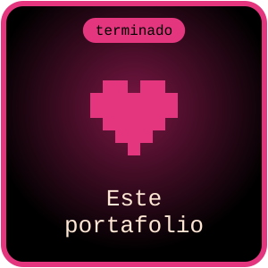
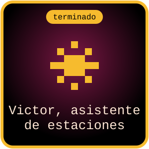
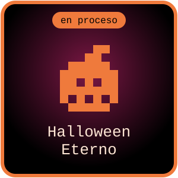
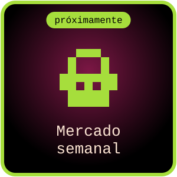
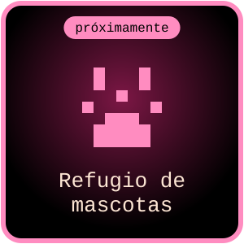
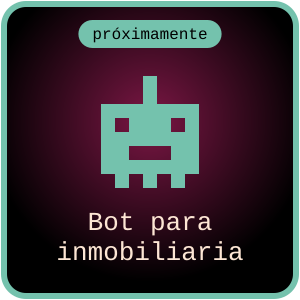
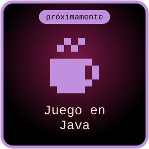
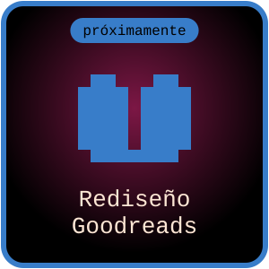

### ☆ Sobre mí

Construyo cosas digitales y documento el proceso, aunque todavía no me sienta lista. Me gusta encontrar qué está fallando en una web o una app y pensar cómo arreglarlo. Extraño cuando internet era más raro y más personal, por eso este perfil se ve así.

<table>
  <tr><td><b>Ubicación</b></td><td>Lima, Perú</td></tr>
  <tr><td><b>Hago</b></td><td>Webs, interfaces y apps pequeñas</td></tr>
  <tr><td><b>Ahora mismo</b></td><td>Aprendiendo React y TypeScript</td></tr>
  <tr><td><b>Estado</b></td><td>Disponible para proyectos freelance</td></tr>
  <tr><td><b>Mood</b></td><td>Programando en pantuflas</td></tr>
  <tr><td><b>Contacto</b></td><td>vanazuazo@email.com</td></tr>
</table>

### ☆ Top 8 proyectos

<table>
  <tr>
    <td align="center"></td>
    <td align="center"></td>
    <td align="center"></td>
    <td align="center"></td>
  </tr>
  <tr>
    <td align="center"></td>
    <td align="center"></td>
    <td align="center"></td>
    <td align="center"></td>
  </tr>
</table>

### ☆ Herramientas

  
  
  
  
  
  
  
  
  
  

**Aprendiendo ahora:**

  
  

### ☆ Visítame

  
  
  
  
  
  
  

© 2026 · hecho por vanacode · se ve mejor en 1024x768 xD

